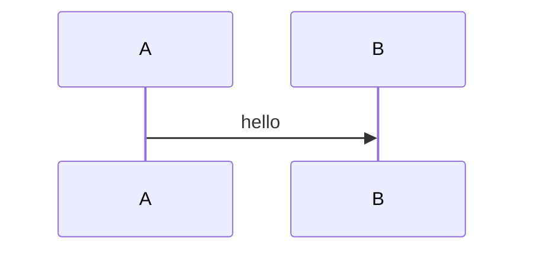

# H2G2 notebook format & primitives

Everything an agent needs to write or change a notebook. The viewer renders these files live; saving a file refreshes open browsers.

## Layout

```
notebooks/<name>/
  notebook.json      { title, description, scope: "general" | "org", created, updated, archived?, tags? }  (archived: true hides it from the library shelf; tags: ["jdm", "org"] — lowercase, a-z 0-9 . _ -, max 32 chars)
  toc.json           { chapters: [ { id, title, file, summary?, children?: [...] } | { id, title, summary, status: "planned" } ] }
  references.json    { categories: [ { id, title, items: [ { id, title, url?, source, chapters?, note?, accessed } ] } ] }
  chapters/<id>.md   one markdown file per chapter
  assets/            svg, html visualizations, data files used by chapters
```

- **Planned chapters** (`"status": "planned"`, no `file`) are the learning plan: shown greyed out, written one at a time on request. Add with `cli.mjs plan`; write with `cli.mjs chapter <nb> --id <planned-id>` (promotes in place). Only planned entries may be freely added, renamed, reordered or dropped.
- TOC order is reading order. `children` nests sub-chapters. Chapter ids are stable slugs; never rename an id that already exists.
- **Topics** are the `## ` headings of a chapter. Each gets a read/unread checkbox and an "ask" button in the viewer, so make every `##` a self-contained, meaningful topic. Use `###` for sub-sections.
- `scope` decides sources: `general` → internet; `org` → Confluence + Teamwork Graph (`twg`) first, internet for background.

## CLI (prefer over hand-editing JSON)

```
node framework/cli.mjs chapter <nb> --title "T" [--after ID | --before ID | --parent ID] [--summary "S"]
node framework/cli.mjs plan <nb> --title "T" --summary "S" [--after ID]      # planned chapter (no file)
node framework/cli.mjs chapter <nb> --id <planned-id>                          # write a planned chapter
node framework/cli.mjs ref <nb> --category "Official docs" --title "T" --url U --source web --chapter ID
node framework/cli.mjs validate <nb>        # run after every change; fix all errors
node framework/cli.mjs toc <nb>
```

Reference categories: reuse existing ones; typical set is `Official docs`, `Articles & blogs`, `Talks & videos`, `Code & examples`, `Internal (Confluence)`, `Internal (Jira/Bitbucket)`, `People & teams`.

## Primitives

Every primitive is plain markdown or a fenced block, so chapters stay readable in any markdown viewer.
Fence options use `key=value` (quote values with spaces): ` ```mermaid title="Write path" `.

### Text, tables, links
- GitHub-flavoured markdown: lists, task lists, tables, footnotes-style emphasis, `<details><summary>` for collapsibles.
- Tables become sortable (click a header); tables with more than 8 rows get a filter box.
- Cross-link chapters/topics: `[see partitions](#/kafka-basics/partitions)`.
- Cite sources inline: `[@ref-id]` → numbered superscript linking to References. Every id must exist in references.json.

### Callouts
```
> [!NOTE] / [!TIP] / [!IMPORTANT] / [!WARNING] / [!CAUTION]
> Text…

> [!DEEPDIVE] Optional title
> Collapsed by default. Use for advanced detail.

> [!EXERCISE] Optional title
> A hands-on task for the reader.
```

### Mermaid diagrams (zoom / pan / fullscreen)
````

````
Any mermaid diagram type works. Keep labels short; quote labels with special characters (`A["foo (bar)"]`).

### SVG (zoom / pan / fullscreen)
````
```svg title="Log segments"
<svg viewBox="0 0 400 120" xmlns="http://www.w3.org/2000/svg">…</svg>
```
```svg src=assets/segments.svg title="Log segments"
```
````
`` images are also zoomable. Always set `viewBox`. Use `currentColor` for strokes/text so diagrams work in light and dark themes.

### HTML visualizations (sandboxed iframe)
````
```viz src=assets/partition-sim.html height=420 title="Partition simulator"
```
```viz height=260
<!doctype html><html><body><canvas id=c></canvas><script>/* … */</script></body></html>
```
````
Runs with scripts enabled but no access to the parent page. May load libraries from CDNs (d3, three.js, chart.js…). Prefer `assets/*.html` files for anything over ~40 lines. Respect `prefers-color-scheme`.

### Runnable code (WASM tools)
Add `run` to a fence to make it editable and executable in the browser:

| Fence | Engine | Notes |
|---|---|---|
| ` ```python run ` | Pyodide (CPython → WASM) | Shared interpreter per page; `print()` output shown; pure-python + Pyodide packages (`import numpy` auto-loads). |
| ` ```sql run ` | SQLite (sql.js WASM) | Shared database per page, so a setup block can create tables for later blocks. Result sets render as tables. |
| ` ```js run ` | Sandboxed iframe | `console.log` captured; return value of last expression shown. |

Options: `title="…"`, `autorun` (run when the chapter opens; use for setup blocks), `hidden` (with `autorun`: run but don't show, e.g. seed data).

### Plain code
Any other fence (` ```java `, ` ```bash `…) renders as a code block with a copy button.

## Writing guidance
- Chapter = one coherent idea, 5–15 minutes of reading. Open with 1–2 sentences on why it matters; end with a short "Key takeaways" list.
- Explain → visualize → let the reader poke at it: pair concepts with a diagram, and add a runnable or viz exploration where it helps.
- Cite non-obvious claims. Never invent org-specific facts (team names, owners, systems); if a source can't be found, say so.
