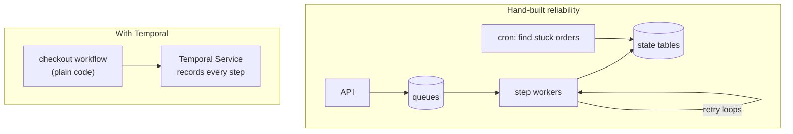
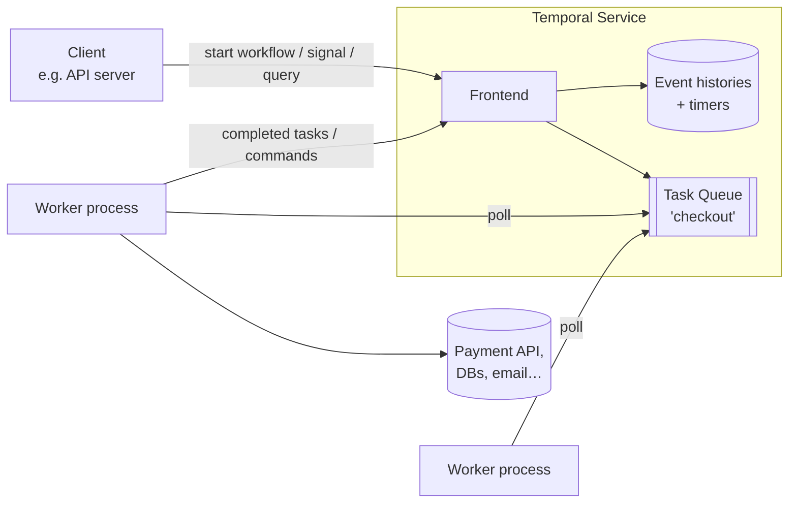
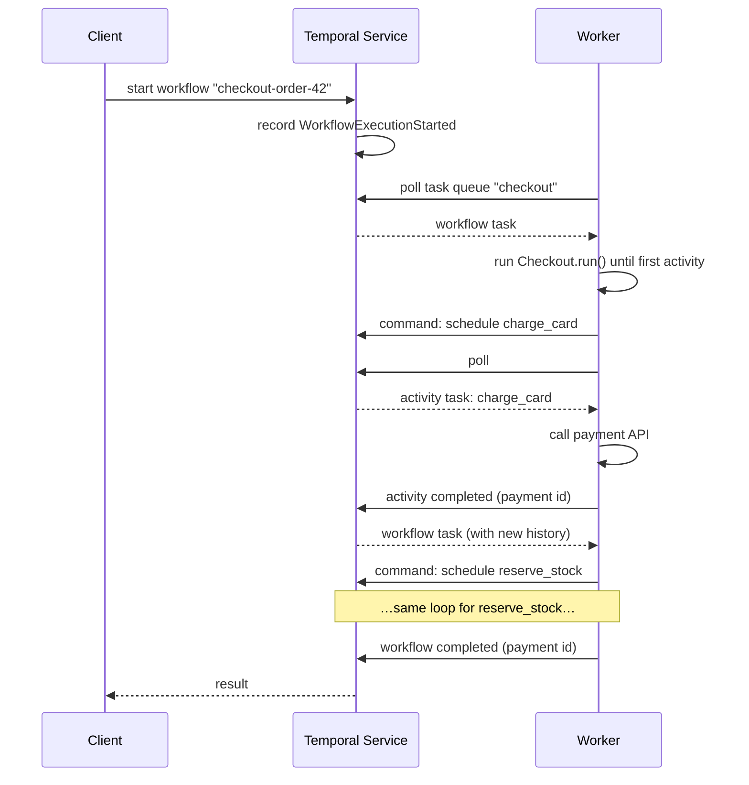

# Durable execution: why Temporal exists

Most interesting business processes don't fit into a single request. They call several services, wait for people or other systems, and have to finish correctly even when machines crash halfway through. Temporal is a platform that lets you write that kind of process as ordinary code, and then **guarantees the code runs to completion** despite failures [@what-is-temporal]. This chapter builds the mental model; use the sticky note at the bottom to ask for the next piece you want to dig into.

## The problem: work that outlives a process

Take an e-commerce checkout. It has to **charge the card**, **reserve stock**, **create a shipment** and **email a receipt**. Written naively, it's four calls in a row:

```python
def checkout(order):
    payment = charge_card(order)        # ✓ money taken
    reserve_stock(order)                # 💥 process crashes here
    create_shipment(order)
    send_receipt(order, payment)
```

If the process dies after the charge, the customer has paid for nothing, and no line of code is still running to notice. The usual fixes turn this function into a small distributed system of its own:

| You end up building | To answer |
|---|---|
| A state table per order (`status = CHARGED`) | "How far did we get?" |
| A queue between each step | "Who picks this up after a crash?" |
| Cron jobs that scan for stuck rows | "What if a message was lost?" |
| Retry loops with backoff and idempotency keys | "What if a downstream service is flaky?" |
| Timers stored in a database | "Cancel the order if not shipped in 7 days" |

Each piece is reasonable; together they bury the four lines of business logic. Temporal's pitch is that this plumbing should be the platform's job, not yours [@what-is-temporal].



## Durable execution in one sentence

Temporal's own definition: the platform "guarantees the Durable Execution of your application code" [@what-is-temporal]. Concretely, a **Workflow Execution** keeps its state and progress through failures because every step is recorded in an **Event History**. After a crash, execution resumes from the last recorded event rather than from scratch [@what-is-temporal].

Three consequences are worth internalising early:

1. **Your code looks sequential.** `charge`, then `reserve`, then `ship`: no state machine, no queue wiring.
2. **Waiting is cheap.** A workflow can sleep for a week or wait for a human. Workflows "can run—and keep running—for years, even if the underlying infrastructure fails" [@temporal-workflows].
3. **Failures become retries, not incidents.** Calls to the outside world are retried automatically according to a policy [@retry-policies].

> [!NOTE]
> "Durable" refers to the *execution*, not just the data. A database makes rows durable; Temporal makes the *position in your code* durable: which line you're on and what every local variable holds.

## Where it came from

Temporal's founders, Maxim Fateev and Samar Abbas, have been building workflow engines for most of their careers. They worked on AWS Simple Workflow Service, then built **Cadence** at Uber. Temporal started as a fork of Cadence by the same team [@maxim-fateev-on-the-oss-startups-podcast] [@se-radio-596-maxim-fateev-on-durable-exe]. If you see Cadence code or blog posts, the core ideas (workflows, activities, event history, replay) carry over almost one-to-one.

## The moving parts

A running Temporal application has four kinds of participants:

| Part | Who runs it | What it does |
|---|---|---|
| **Temporal Service** | Temporal Cloud, or you (self-hosted) | The Temporal Server (written in Go) plus a database. Stores event histories, timers and task queues, and decides what should happen next [@what-is-temporal]. |
| **Workers** | You | Processes built with a Temporal SDK. They **poll task queues**, run your workflow and activity code, and report results back [@temporal-workers]. |
| **Task Queues** | Temporal Service | Named queues that connect the service to workers. Each worker entity polls exactly one task queue [@temporal-workers]. |
| **Clients** | You (API servers, CLIs, cron jobs…) | Start workflows, send them messages, and read their results. |

The most important line in the docs: the Temporal Service "doesn't execute any of your code" [@temporal-workers]. Your code, credentials and network access stay on your workers. The service only stores state and hands out tasks.



Workers pull work; the service never pushes to them. That's why you can scale by just starting more worker processes, and why a worker that crashes simply stops polling. Its tasks time out and go to another worker.

## Workflows and activities

Your code is split into two kinds of functions, and the split is the heart of the programming model:

| | **Workflow** | **Activity** |
|---|---|---|
| Purpose | Orchestration: the order of steps, decisions, waiting | One well-defined action: call an API, write a file, send an email [@temporal-activities] |
| Talks to the outside world? | No, only through activities, timers and messages | Yes, any library, any I/O [@temporal-activities] |
| Must be deterministic? | **Yes**, because the code is *replayed* from its history after failures | No |
| Retried by default? | No [@retry-policies] | Yes, with exponential backoff [@retry-policies] |
| Typical duration | Seconds to years | Milliseconds to hours |

A useful rule of thumb: **if it touches the network, the disk, the clock or randomness, it's an activity.** The workflow is the conductor; activities are the musicians.

## A first workflow

Here's the checkout's skeleton with the Temporal Python SDK. It follows the shape of the official samples [@temporal-python-samples]; every SDK (Go, Java, TypeScript, .NET, Ruby, PHP) has the same concepts.

```python title="activities.py"
from temporalio import activity

@activity.defn
async def charge_card(order_id: str) -> str:
    ...  # call the payment provider; return a payment id

@activity.defn
async def reserve_stock(order_id: str) -> None:
    ...
```

```python title="workflows.py"
from datetime import timedelta
from temporalio import workflow

with workflow.unsafe.imports_passed_through():
    from activities import charge_card, reserve_stock

@workflow.defn
class Checkout:
    @workflow.run
    async def run(self, order_id: str) -> str:
        payment_id = await workflow.execute_activity(
            charge_card, order_id, start_to_close_timeout=timedelta(seconds=30))
        await workflow.execute_activity(
            reserve_stock, order_id, start_to_close_timeout=timedelta(seconds=30))
        return payment_id
```

```python title="worker.py — runs your code"
client = await Client.connect("localhost:7233")
worker = Worker(client, task_queue="checkout",
                workflows=[Checkout], activities=[charge_card, reserve_stock])
await worker.run()
```

```python title="starter.py — a client"
client = await Client.connect("localhost:7233")
result = await client.execute_workflow(
    Checkout.run, "order-42", id="checkout-order-42", task_queue="checkout")
```

Notice what's missing: no state table, no queue wiring, no retry loop. If the worker dies between `charge_card` and `reserve_stock`, another worker picks the workflow up and continues **at `reserve_stock`**, with `payment_id` intact. That works because the service replays the workflow's event history, which is a good thing to ask about next.



> [!EXERCISE] Run Temporal locally
> Install the Temporal CLI and run `temporal server start-dev`. It starts a development server with the gRPC frontend on port **7233** and the Web UI on **http://localhost:8233** [@temporal-cli-server-start-dev]. Data is in-memory unless you pass `--db-filename`. Then clone the Python samples [@temporal-python-samples], run `hello_activity`, and open the Web UI to look at the workflow's event history.

## Key takeaways

- Temporal provides **durable execution**: your code's progress survives crashes because every step is recorded in an event history.
- The **Temporal Service** stores state and hands out tasks; **your workers** run all the code. The service never executes it.
- **Workflows** orchestrate and must be deterministic; **activities** do side effects and are retried automatically.
- Code stays sequential and readable. The reliability plumbing (state, queues, retries, timers) moves into the platform.
